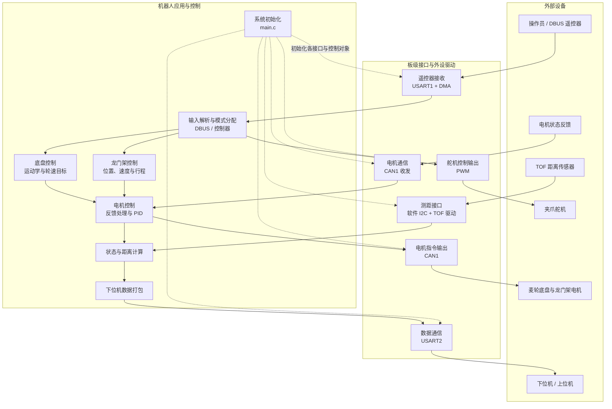

# STM32 麦轮底盘与龙门架控制项目

本仓库基于 [RoboVigor/RV-CornerStone](https://github.com/RoboVigor/RV-CornerStone) 电控框架开发，面向搭载龙门架与夹爪的麦克纳姆轮机器人。当前 Keil MDK 工程目标芯片为 **STM32F427II**，对应工程文件为 [`mdk/infantry.uvprojx`](mdk/infantry.uvprojx)。

> 本文以仓库当前启用的 `user/infantry/` 业务代码为准。仓库包含较多框架模块和其他机器人功能；要修改本车逻辑时，先从 `main.c`、`interrupt.c` 和 `Driver_My*.c` 追踪调用，不要仅凭目录名假设某个框架模块正在运行。

## 功能与当前控制映射

| 子系统 | 当前组成 | 代码入口/关键参数 |
| --- | --- | --- |
| 麦轮底盘 | LF、RF、LB、RB 四个 3508；遥控器摇杆换算为平移与旋转速度，再转换为各轮目标 RPM | `Driver_MyController.c`、`Driver_MyChassis.c`、`Driver_MyChassis.h` |
| 龙门架 | X1 一个电机，Y1/Y2 两个电机；速度斜坡模式与位置保持模式、软件行程限制 | `Driver_MyController.c`、`Driver_MyCrane.c`、`Driver_MyCrane.h` |
| 电机反馈与驱动 | CAN1 接收 0x201–0x207 反馈帧；速度 PID 输出通过 CAN 发送 | `user/infantry/interrupt.c`、`Driver_MyMotor3508.c`、`Driver_PID.c` |
| 遥控器 | USART1 接收 DBUS 18 字节数据，DMA 搬运，串口空闲中断解码摇杆和开关 | `Driver_MyUSART.c`、`Driver_MyDMA.c`、`interrupt.c` |
| 夹爪舵机 | PWM 输出，当前映射到 PD12；由控制器中的 S1 开关状态驱动 | `main.c`、`Driver_MyServo.c`、`Driver_BSP.c` |
| TOF 测距 | VL53L1X 通过软件 I2C 测量底盘距离 | `Driver_MyTof.c`、`Driver_MyTof.h`、`Driver_MyI2C.c` |
| 下位机数据 | USART2 以 115200 波特率输出底盘距离及龙门架 X/Y 距离 | `main.c`、`Driver_MySerial.c`、`Driver_MySerial.h` |

## 项目架构与数据流

下图从系统层次概括“外部设备 → 板级接口 → 业务控制 → 执行器/数据输出”，突出模块职责和反馈闭环；具体函数、中断时序与参数见后文改动指南。

**架构说明：** `user/infantry/` 负责系统初始化、中断入口和主循环；`driver/` 提供外设接口及底盘、龙门架、电机、传感器等驱动；`library/` 与 `device/` 提供通用库和芯片支持。遥控器输入进入业务控制后形成执行器目标，电机反馈通过 CAN 回到电机控制，TOF 和电机状态用于距离计算，结果通过 USART2 对外发送。实际运行中，周期控制由定时器中断触发，测距与数据发送在 `main()` 主循环执行；本图展示系统职责与主要数据流，不表示精确时序。

## 从哪里开始改

按需求从下面的“改动入口”开始，避免在不相关的框架文件里改出重复实现：

| 想要修改 | 首选修改位置 | 需要同步检查 |
| --- | --- | --- |
| 调整遥控器通道如何控制底盘或龙门架；改变 S2 模式映射 | `driver/src/Driver_MyController.c` | `user/infantry/interrupt.c` 的 TIM2/TIM3 调用关系；DBUS 原始通道映射见 `Driver_MyUSART.c` |
| 修改底盘几何、轮半径或运动学公式 | `driver/inc/Driver_MyChassis.h`、`driver/src/Driver_MyChassis.c` | `main.c` 中四个电机指针、正反方向；轮子悬空验证移动方向和转向 |
| 修改龙门架行程、速度、斜坡、齿轮半径或夹爪离地偏置 | `driver/inc/Driver_MyCrane.h` | `Driver_MyCrane.c` 的限位判断、距离公式；`main.c` 初始化的电机减速比和方向 |
| 修改电机速度环/位置环 PID 或电机对应关系 | `user/infantry/main.c` | `interrupt.c` CAN ID 映射、`Driver_MyMotor3508.c` 方向及连续编码器计算、对应机构安全性 |
| 修改传感器引脚、I2C 接线或测距偏置 | `driver/inc/Driver_MyTof.h`、`driver/inc/Driver_MyI2C.h` | `Driver_MyTof.c` 上电与启动流程；确认传感器型号及实机接线 |
| 修改舵机 PWM 引脚或角度动作 | `main.c` 中 PWM 初始化、`driver/src/Driver_BSP.c` 的端口映射、`Driver_MyServo.c` | PWM 通道、周期/脉宽范围和机械限位；先断开连杆或降低风险进行验证 |
| 修改 USART2 输出内容/帧格式 | `main.c` 主循环和 `user/infantry/handle.h` | 接收端解析、字节长度、端序、单位；同步更新本 README 的协议说明 |
| 修改外设时钟、串口、定时器、CAN 初始化 | `driver/src/Driver_BSP.c` 对应 `BSP_*` 函数 | NVIC 优先级、引脚复用、时钟树、所有依赖该外设的收发逻辑 |

### 推荐修改步骤

1. **先确认代码路径**：从本节表格定位入口，沿函数调用确认实际执行点；如果一个函数只在注释中出现，它不会产生运行效果。
2. **确认输入、单位与方向**：读调用点和函数定义，明确摇杆量程、速度单位、编码器方向、距离单位及 CAN ID，不凭变量名猜测。
3. **修改配置优先于复制逻辑**：机械参数和限位优先集中改对应头文件宏；行为变化改对应驱动函数；避免同一参数在多个文件各写一份。
4. **核对全部关联配置**：新电机至少同时检查结构体定义/初始化、PID 初始化、集合指针、CAN 接收 ID、CAN 发送报文槽位及方向。只改其中一处可能导致编译成功但电机不受控。
5. **构建后分阶段验证**：先检查编译，再断开负载或让轮子离地，核实方向和零输入行为；最后低速、短行程验证限位、通讯和测距。变更后的参数必须与机械实物重新核对。

## 当前遥控器控制逻辑

`Driver_MyController.c` 的 `MyController_Move()` 根据 DBUS 的 `s2` 开关分发控制：

- `s2 == 1`：调用 `Crane_Calculate()`，当前将 `r2y` 作为 X1 指令、`r1y` 分别作为 Y1/Y2 指令。
- `s2 == 3`：将 `r1y`、`r1x`、`r2x` 分别换算为底盘 `Vx`、`Vy`、`Vw`，并调用 `Chassis_Calculate()`。当前 `Vx` 正向在 0.6 到 1 之间另加 0.1。
- `s2 == 2`：向 CAN1 的 `0x200` 和 `0x1FF` 发送零电流指令。
- 其他 `s2` 状态：`Move()` 不执行上述底盘/龙门架分支；舵机控制仍会调用 `SetServoByController(data->s1)`。

`MyController_Stay()` 在另一周期中断中，根据模式为底盘或龙门架发送零目标，意图是在切换/保持阶段继续运行对应控制环。调整模式分支时要一并理解 `Crane_Control_Loop()` 的状态切换和 PID 状态，不能只更改 `Move()` 的输入映射。

DBUS 数据在 `Driver_MyUSART.c` 解码：摇杆经 11 位字段解码并减去 1024；遥控器开关 `s1/s2` 按位域取值。`interrupt.c` 当前在 USART1 空闲中断里停 DMA、调用 `DBUS_Decode()` 并重启 DMA。虽然中断中计算了接收长度 `rx_len`，当前代码没有用它做长度校验；若修改接收方案或排查偶发错误，应检查 DMA 传输完整性和解码前的有效长度，而不要假定已有校验。

## 电机、底盘与龙门架改动指南

### 增加或替换一台 3508 电机

当前全局电机和 PID 实例集中声明在 `user/infantry/handle.h`，运行时初始化在 `user/infantry/main.c`。CAN 反馈按 `user/infantry/interrupt.c` 中的标准 ID 分派：底盘使用 `0x201`–`0x204`，龙门架使用 `0x205`–`0x207`。修改电机数量或接线时，按以下顺序逐项核对：

1. 在句柄头文件声明电机对象和关联 PID 对象。
2. 在 `main.c` 用实际电机方向、减速比及 PID 指针调用 `Motor_3508_Init()`，随后分别调用速度/位置 PID 初始化。
3. 如果该电机属于某个集合，在相同初始化阶段把成员指针指向正确对象。
4. 在 CAN 接收中断中把实际反馈 ID 映射到该电机，并确认连续编码器更新是否适用于该机构。
5. 修改发送报文 ID 及数据槽位分配，并确认 CAN 总线上的电调和电机反馈 ID 与配置一致。
6. 上电前先确保输出目标为零。轮子离地或机构解除负载后单独验证正方向，再以低目标值验证反馈方向与输出方向一致。

### 调整底盘运动学

底盘逆运动学位于 `Driver_MyChassis.c` 的 `Chassis_Calculate()`：先用 `L`、`W` 得到旋转项系数，再计算四轮线速度，最后由 `Velocity2RPM()` 按轮半径换算成 RPM。当前调用使用 `Chassis_L`、`Chassis_W`，轮半径宏 `Wheel_radius` 定义在 `Driver_MyChassis.h`。修改时应确认：

- `Vx`、`Vy`、`AngularVelocity` 与机构坐标系正方向一致，旋转项的符号和电机安装方向匹配。
- `L`、`W`、轮半径使用米；摇杆速度换算以及 `Velocity2RPM()` 的单位保持一致。
- `SendChassis_ByRPM()` 会乘以每个电机的方向符号和减速比，再交给速度 PID；不要在运动学和电机驱动两处重复补偿方向或减速比。
- 空载测试时单独验证前进、横移、旋转，再验证组合运动；如果方向反了，先区分运动学符号错误还是某个电机 `IsPositive` 配置错误。

### 调整龙门架行程或距离换算

X1、Y1、Y2 的软件上/下限、目标速度、斜坡步长和齿轮半径定义在 `Driver_MyCrane.h`。`Crane_Control_Loop()` 在接近限位时强制进入位置保持；遥控器回中时捕获当前位置作为目标位置。距离换算在 `Calculate_Crane_X_distance()` / `Calculate_Crane_Y_distance()`，依赖连续编码器计数、减速比、齿轮半径、回零基准和夹爪离地偏置。

当前 `MyCrane_Make_Zero()` 的名称容易造成误解：它只把目标位置设置为配置中的软件最小位置，并没有读取实体限位开关或执行闭环回零确认。电机是否安全、限位是否可信，取决于反馈与机构参数。改动最小值、方向、减速比或机械结构后，务必先验证电机低速运动方向、当前位置坐标与距离显示；不要在未确认机械限位和急停措施前直接用旧限位值运行。

## 初始化、中断与时序

- `user/infantry/main.c` 是本项目主入口：先初始化串口及传感器、遥控器 DMA、舵机、电机与 PID，设置集合指针，再初始化 CAN 和定时器；持续循环读取 TOF、换算距离并发送数据。
- `user/infantry/interrupt.c` 处理 USART1 空闲中断、CAN1 电机反馈和 TIM2/TIM3 控制调用。中断中应避免放入阻塞等待、长时间计算或大量串口发送；周期控制逻辑的运行时间会影响反馈及 CAN 指令时序。
- TIM2、TIM3 的预分频器和自动重装值写在 `BSP_TIM2_Init()`、`BSP_TIM3_Init()`（`driver/src/Driver_BSP.c`）。中断频率由实际 APB1 定时器时钟、`Prescaler` 与 `Period` 共同决定，修改时需按当前时钟树重新计算并用示波器/逻辑分析仪或调试计数实测；不要仅沿用注释里的频率描述。
- CAN 发送与接收对应关系需要一起检查：接收中断按电机 ID 更新反馈，控制函数将计算值打包发送。若电机无响应，先检查总线、波特率、过滤器和 ID，再检查目标值、反馈值及 PID 输出。
- FreeRTOS 头文件、框架和任务文件仍在仓库内，但当前此入口 `main()` 使用 `while (1)` 执行 TOF 读取和串口发送；不要因仓库包含 FreeRTOS 就假定这段主循环已由调度器接管。

## USART2 下位机帧格式

当前主循环通过 USART2 发送固定 **9 字节**，波特率 115200：

| 偏移 | 内容 | 格式 |
| ---: | --- | --- |
| 0 | 帧头 | `0xAA` |
| 1–2 | 底盘 TOF 距离 | 无符号 16 位，高字节优先，单位 mm |
| 3–4 | X 轴距离 | 无符号 16 位，高字节优先，单位 mm |
| 5–6 | Y 轴距离 | 无符号 16 位，高字节优先，单位 mm |
| 7–8 | 帧尾 | `0x0D 0x0A` |

生成帧的数组是 `Lower_Computer_Message[9]`，各距离的高低字节在 `main.c` 中填充，发送由 `Serial_SendArray()` 完成。当前帧没有校验和、序号或长度字段；接收端应依靠帧头、固定长度和帧尾同步。更改帧字段时，发送端与接收端必须同步更新，并检查数值范围是否会超出 16 位无符号整数。

## 目录与文件职责

| 路径/文件 | 用途 |
| --- | --- |
| `core/` | Cortex-M4 内核支持及启动文件 |
| `device/inc/`、`device/src/` | STM32F4 标准外设库 |
| `driver/inc/Driver_BSP.h`、`driver/src/Driver_BSP.c` | GPIO、USART、CAN、TIM、PWM 等板级外设初始化 |
| `driver/inc/Driver_My*.h`、`driver/src/Driver_My*.c` | 本项目定制的电机、底盘、龙门架、传感器、串口等驱动 |
| `user/infantry/main.c` | 初始化顺序、主循环、测距与下位机帧发送 |
| `user/infantry/handle.h` | 全局对象声明/定义及业务驱动聚合头文件 |
| `user/infantry/interrupt.c` | USART、CAN、定时器和异常中断服务函数 |
| `user/infantry/config.h` | 机器人配置宏；具体参数及默认值也需结合引用的配置头文件检查 |
| `user/infantry/tasks.c`、`tasks.h` | RTOS 任务相关文件；与当前 `main()` 主循环是否衔接需以调用点为准 |
| `user/infantry/protocol.h` | 协议相关生成文件，若由工具生成应修改源定义并重新生成 |
| `library/` | FreeRTOS、数学库、传感器及通用组件 |
| `mdk/infantry.uvprojx` | Keil 工程，包含芯片、编译宏、源文件和头文件配置 |

## 构建与调试

1. 安装并打开 Keil MDK，加载 `mdk/infantry.uvprojx`，确认所需芯片包可用，选择工程中的目标配置并执行 Build。
2. 当前工程芯片为 STM32F427II，工程宏包含 `STM32F427_437xx`、`USE_STDPERIPH_DRIVER`、`ROBOT_LOOP_ONE` 等。更换车辆/硬件时，先确认宏定义和工程文件中实际加入的源文件，不要只改某个头文件里的宏而遗漏工程配置。
3. 编译报未定义符号时，检查对应 `.c` 是否已加入 Keil 工程、头文件路径是否正确，以及函数声明与定义是否匹配。Keil 工程新增文件通常需要在 IDE 工程组中显式加入。
4. 修改完先执行全量 Build，确认无新增错误/警告；再按“先断负载/离地、零目标、低速、短行程”的顺序做硬件验证。电机方向、机械限位和急停功能未确认前，不要直接上完整负载。
5. 调试遥控器时观察 DMA 接收缓冲区及 `usart1_data_decoded`；调试电机时观察 CAN ID、机械角度、`total_ecd`、转速和 PID 输出；调试测距时分别核对 VL53L1X 状态、原始距离与偏置后的结果；调试下位机时用串口工具按上表逐字节检查帧。
6. 记录本次使用的板卡、接线、编译配置、参数和硬件验证结果。当前仓库没有在此 README 中承诺的主机侧自动化测试流程；没有实机验证的行为应明确标注，不能以“编译通过”代替硬件验收。

## 协作约定

- 分清共享框架代码与本车业务代码；车型专属逻辑优先放在 `user/infantry/` 或本项目定制的 `Driver_My*.c`，避免直接改变会影响其他目标的通用驱动。
- 修改协议、单位、引脚、电机方向、限位或控制周期时，同步检查所有调用端、接收端和硬件配置，并更新本文相应章节。
- `protocol.h` 若为生成结果，应修改相应协议源并执行生成流程，不要只手工改生成文件。
- 保持改动聚焦、文件使用 UTF-8 编码；提交说明中列出修改内容、编译结果、测试环境、硬件条件和未验证事项。
